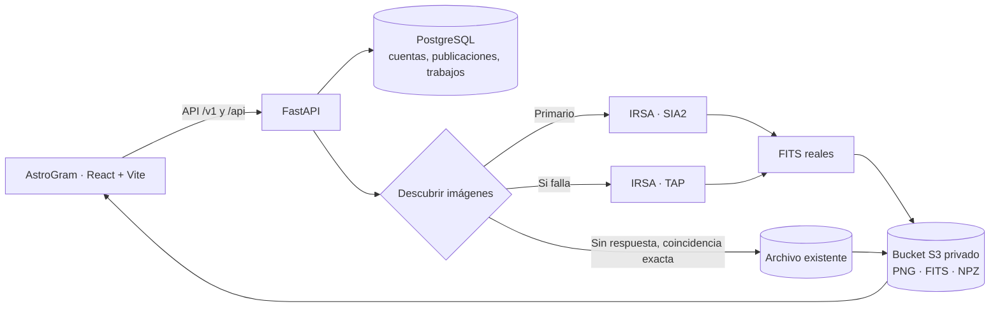

<div align="center">


# AstroGram

### El cielo cambia. Descúbrelo, compáralo y compártelo.

Una comunidad astronómica donde las observaciones reales de **SPHEREx** se encuentran con una experiencia social: explora distintas épocas de una región del cielo, prepara su revelado y comparte lo que te llama la atención.

**[🌌 Abrir AstroGram](https://astrogram.up.railway.app/) · [Arquitectura](docs/ARCHITECTURE.md) · [Ejecutar localmente](docs/DEVELOPMENT.md) · [Rigor científico](docs/SCIENCE.md)**

[](https://github.com/Drakeneess/spherex-social/actions/workflows/ci.yml)


</div>

---

## ✦ Una plataforma, dos formas de explorar

| 🔭 **Explorador de épocas** | ✨ **Comunidad AstroGram** |
|:---|:---|
| Busca observaciones reales por coordenadas, campo y detector. | Publica observaciones astronómicas, fotografías o solo texto. |
| Compara varias épocas FITS y examina cambios aparentes. | Encuentra **Astroamigos**, hashtags y publicaciones. |
| Ajusta el revelado **sin alterar los FITS** originales. | Da **Me encoheta**, comenta, comparte, guarda y sigue perfiles. |
| Marca regiones, inspecciona candidatos de movimiento y guarda observaciones. | Descubre contenido con un feed **Para ti / Siguiendo / Recientes**. |

### Lo que hace especial a AstroGram

- **Parpadeo entre épocas:** compara visualmente imágenes reales en distintos momentos. Los resultados conservan sus fechas y procedencia.
- **Estudio de revelado:** paletas, curvas de contraste, gamma, encuadres y vista original; edición visual no destructiva.
- **Búsqueda que sobrevive a la navegación:** trabajos persistentes en PostgreSQL; imágenes y productos científicos en almacenamiento privado S3.
- **Respaldo ante fallos de IRSA:** descubrimiento por **SIA2**, alternativa **TAP asíncrono** y, si ambas vías fallan, recuperación de un archivo anterior **solo cuando la consulta coincide exactamente**.
- **Experiencia social:** perfiles personalizables, notificaciones en tiempo real, publicaciones con vistas de épocas y recomendaciones explicables.
- **Exploración lúdica:** minijuego educativo, misiones de incorporación, sonidos de interfaz opcionales y una carta zodiacal como sorpresa de cumpleaños.

> [!IMPORTANT]
> **AstroGram es un prototipo exploratorio, no un sistema de descubrimiento astronómico validado.** Un candidato de movimiento no confirma un nuevo objeto, un asteroide ni Planet X. Las vistas de demostración son sintéticas y están identificadas; **nunca se presentan como observaciones reales**. Consulta [alcance científico y limitaciones](docs/SCIENCE.md).

## 🪐 Cómo funciona



La API separa los datos de la comunidad de los trabajos astronómicos. Una publicación puede reabrir **las mismas imágenes archivadas** sin solicitar una búsqueda duplicada a IRSA.

**Tecnologías:** React 19, TypeScript, Vite, FastAPI, SQLAlchemy, Alembic, PostgreSQL, Astropy, Astroquery, PyVO, NumPy, almacenamiento compatible con S3 y Railway.

Más detalles: [arquitectura y flujo de datos](docs/ARCHITECTURE.md).

## ⚡ Ejecutar localmente

**Necesitas:** Python 3.12, Node.js 22, Docker con Compose y npm.

1. **Base de datos** — desde la raíz del repositorio:

   ```bash
   docker compose up -d postgres
   ```

2. **API** — abre otra terminal:

   ```bash
   cd server
   cp .env.example .env
   python -m venv .venv
   source .venv/bin/activate
   python -m pip install -r requirements.txt
   python -m alembic upgrade head
   python -m uvicorn app:app --reload --port 8000
   ```

3. **Web** — en una tercera terminal:

   ```bash
   cd web
   npm ci
   npm run dev
   ```

4. Abre **http://127.0.0.1:5173**. La API estará en **http://127.0.0.1:8000/docs**.

En Windows PowerShell, utiliza `Copy-Item .env.example .env` y `.venv\Scripts\Activate.ps1` en lugar de `cp` / `source`. El proxy de desarrollo apunta a **la API local** tanto para `/api` como para `/v1`, de modo que las pruebas no crean contenido accidentalmente en producción.

**Para comenzar sin depender de IRSA**, usa la vista de demostración claramente identificada. Las búsquedas reales requieren conectividad y disponibilidad de NASA/IPAC IRSA.

Configuración completa, variables, resolución de errores y despliegue: [docs/DEVELOPMENT.md](docs/DEVELOPMENT.md).

## 🧪 Calidad y pruebas

```bash
# Frontend: comprobación TypeScript, build y tests
cd web
npm ci
npm run build
npm test

# API: pruebas, integración y contratos
cd ../server
python -m pytest -q
```

GitHub Actions comprueba **web**, **API** y **eventos en PostgreSQL** con la configuración de [.github/workflows/ci.yml](.github/workflows/ci.yml). Las migraciones se gestionan con Alembic; no se crea el esquema automáticamente en cada petición.

## 📁 Estructura del repositorio

```text
.
├── web/
│   ├── src/components/     # Feed, perfiles, posts, revelado y UI
│   ├── src/pages/          # Explorador de épocas y juego
│   ├── src/lib/            # Cliente API, estado y utilidades
│   └── tests/
├── server/
│   ├── app.py              # Entradas astronómicas y aplicación FastAPI
│   ├── social_api/         # API de comunidad, autenticación y tiempo real
│   ├── persistent_sky.py   # Trabajo y recuperación de épocas
│   ├── sky_storage.py      # PNG/FITS/NPZ privados
│   ├── alembic/            # Migraciones versionadas
│   └── tests/
├── docs/                   # Arquitectura, desarrollo y criterios científicos
├── compose.yaml            # PostgreSQL para desarrollo
└── .github/workflows/ci.yml
```

## 📚 Documentación

| Documento | Contenido |
|---|---|
| [Arquitectura](docs/ARCHITECTURE.md) | Servicios, persistencia, imágenes, búsqueda y rutas principales |
| [Desarrollo y despliegue](docs/DEVELOPMENT.md) | Requisitos, entorno local, pruebas, variables y Railway |
| [Alcance científico](docs/SCIENCE.md) | Procedencia, método, advertencias y límites del análisis |
| [Contribuir](CONTRIBUTING.md) | Convenciones, cambios pequeños y criterios de aceptación |

## 🔭 Datos y atribución

Las observaciones astronómicas provienen de **NASA/IPAC Infrared Science Archive (IRSA)** y de los productos disponibles de la misión **SPHEREx**. AstroGram es un proyecto independiente: **no es un producto oficial de NASA, IPAC ni de la misión SPHEREx**.

- [NASA/IPAC IRSA](https://irsa.ipac.caltech.edu/)
- [SPHEREx en IRSA](https://irsa.ipac.caltech.edu/Missions/spherex.html)
- [Documentación de acceso a datos SPHEREx](https://irsa.ipac.caltech.edu/spherex-archive-documentation/spherex-data-access/)

---

<div align="center">
  <sub>Diseñado para quienes quieren mirar el cielo, hacer preguntas y compartir sus observaciones.</sub>

  <br />
  <strong>AstroGram · Soñadores del Cosmos</strong>
</div>
