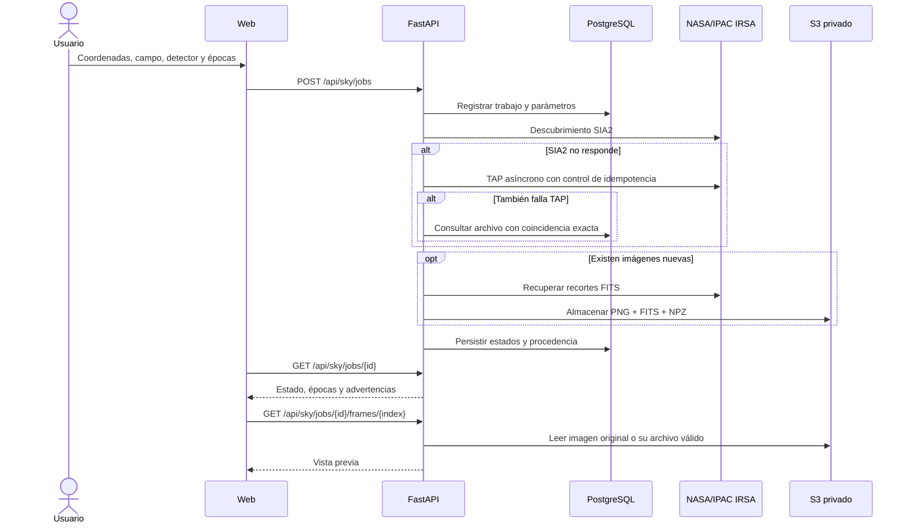

# Arquitectura de AstroGram

[← Volver a la portada](../README.md) · [Desarrollo](DEVELOPMENT.md) · [Alcance científico](SCIENCE.md)

AstroGram combina dos dominios que comparten aplicación, pero **no** deben confundir sus responsabilidades: una comunidad social y un explorador de observaciones astronómicas.

## Componentes

| Capa | Código | Responsabilidad |
|---|---|---|
| Interfaz | `web/src/App.tsx`, `web/src/components/`, `web/src/pages/` | Navegación, feed, perfiles, búsqueda global, explorador, revelado y UI responsive |
| Cliente HTTP | `web/src/lib/api.ts` | Contratos tipados para `/v1` y `/api` |
| Social | `server/social_api/` | Auth, usuarios, posts, recomendaciones, interacciones, búsquedas, notificaciones |
| Astronomía | `server/app.py`, `server/persistent_sky.py` | Descubrimiento IRSA, trabajos persistentes, reproyección, parpadeo |
| Procesamiento | `server/sky_candidate_search.py`, `server/sky_reveal.py` | Candidatos experimentales, revelado desde datos reales |
| Metadatos | PostgreSQL + SQLAlchemy + Alembic | Usuarios, publicaciones, observaciones, estados de trabajos, eventos |
| Imágenes | `server/sky_storage.py`, `server/post_storage.py`, `server/profile_storage.py` | Objetos privados S3 / archivos locales durante desarrollo |

La aplicación web se sirve con Nginx, que remite `/api` y `/v1` a FastAPI mediante el **mismo origen web**. En desarrollo, Vite realiza ese proxy hacia la instancia local.

## Flujo de una búsqueda astronómica

El cliente puede continuar navegando mientras la API procesa un trabajo y volver a abrirlo después. El procesamiento y sus etapas viven en el servidor, no en la vida de una pestaña.

**Resultados archivados:** si IRSA no responde, un trabajo previo solamente se reutiliza si coinciden exactamente RA, Dec, campo, detector y número de épocas. El nuevo trabajo referencia internamente los objetos ya almacenados; no necesita duplicar los FITS. En el cliente se indica que son observaciones **archivadas**, no imágenes nuevas.

**Trabajos TAP:** la creación de un trabajo remoto puede devolver un 502 ambiguo. El sistema guarda la intención antes del POST, no reenvía automáticamente una creación sin confirmar y puede reanudar trabajos cuyo identificador remoto sí se guardó.

## Formatos en almacenamiento

| Objeto | Prefijo | Motivo |
|---|---|---|
| Vista rápida PNG | `sky/v1/` | Dibujar la observación y el parpadeo |
| FITS original | `sky/science/v1/` | Conservar valores y cabeceras científicas |
| NPZ de píxeles | `sky/science/v1/` | Revelado rápido sin alterar el FITS |
| Medios sociales | `social/media/v1/` | Fotografías optimizadas en WebP y miniaturas |

Los FITS pueden ocupar bastante más que los PNG: **optimizar el almacenamiento sin eliminar la procedencia científica** es una restricción explícita del proyecto. El archivo se almacena en un bucket privado; la API entrega vistas autorizadas sin exponer credenciales S3.

## API: rutas orientativas

| Propósito | Ruta |
|---|---|
| Salud y preparación | `GET /v1/health`, `GET /v1/ready` |
| Cuenta | `POST /v1/auth/register`, `POST /v1/auth/login`, `POST /v1/auth/refresh` |
| Comunidad | `GET /v1/feed?mode=for_you`, `GET /v1/search?q=...` |
| Publicación | `POST /v1/posts`, `GET /v1/posts/{id}` |
| Observaciones guardadas | `GET /v1/observations/{id}` |
| Parpadeo publicado | `POST /v1/posts/{id}/blink` |
| Nueva búsqueda | `POST /api/sky/jobs` |
| Estado de búsqueda | `GET /api/sky/jobs/{id}` |
| Imagen de una época | `GET /api/sky/jobs/{id}/frames/{index}` |
| Revelado | `POST /api/sky/jobs/{id}/frames/{index}/reveal` |
| Movimiento experimental | `GET /api/sky/jobs/{id}/candidates` |
| Eventos | `GET /v1/events` (SSE) |

El contrato completo y los campos vigentes pueden consultarse en `/docs` y `/openapi.json` del servidor local.

## Recomendaciones y sincronización

- **Para ti**: ranking heurístico y explicable que combina cuentas seguidas, coincidencia de hashtags con interacciones públicas, recencia, popularidad limitada y diversidad de autores. No es un modelo entrenado.
- **Siguiendo**: publicaciones públicas de las cuentas seguidas.
- **Recientes**: orden cronológico de las publicaciones públicas.
- **Sincronización**: PostgreSQL `LISTEN/NOTIFY` y Server-Sent Events notifican cambios; los endpoints REST siguen siendo la fuente de verdad.

## Seguridad y límites

Las publicaciones privadas no forman parte del feed público ni de las recomendaciones. Los secretos de autenticación, base de datos y S3 se configuran en el entorno de ejecución, **nunca** mediante variables de Vite publicadas al navegador.

Para riesgos científicos, posibles falsos positivos y diferencias entre material sintético y real, consulta [SCIENCE.md](SCIENCE.md).

---

**Mantenimiento:** mantener esta página como una descripción del comportamiento **actual**. El historial de experimentos y sprints anteriores se consulta en los commits y PR, no en la portada pública.
